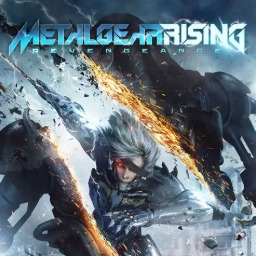

<h1 align=center>Metal Gear Rising: Revengeance — Nintendo Switch port (deko3d)</h1>

An experimental native Nintendo Switch port of the Xbox 360 version of **Metal Gear Rising: Revengeance** (2013).

It is not an emulator. The PowerPC code of the game's `default.xex` is statically recompiled to C++ with
[ReXGlue](https://github.com/rexglue/rexglue-sdk) and compiled for the Switch. The game's Direct3D calls are drawn by
[Renut](https://github.com/masterspike52/reNut)'s renderer on [plume](https://github.com/renderbag/plume)'s deko3d
back end (the Switch's own graphics API, no Vulkan driver), the road [sa2-nx](https://github.com/chanseyisthebest/sa2-nx)
took for its 1.0.3.

> [!IMPORTANT]
> This repository contains **no game files and no code or data from the game**. You need your own copy of the
> Xbox 360 game. Everything made from it (the recompiled code, the translated shaders, the game folder) is made on
> your own computer.

## Status

| | |
|---|---|
| Boots, menus, title, in-game | yes |
| Frame rate (handheld, 720p internal, CPU 1785 MHz / GPU 768 MHz) | menus 55–60 FPS, gameplay 40–52 FPS |
| Frame rate at stock clocks | not measured yet |
| Shaders | all 1,202 of the game's shader containers are read from `media/data000.cpk`; compiled for the console once, at the first start (a progress screen) |
| Tested on | one Switch (Atmosphère, title takeover) |

Report problems with the `logs/` folder of the game's SD folder.

## Requirements

- A Switch with custom firmware (Atmosphère) and the homebrew menu started by **title takeover** (hold R while
  starting a game) — applet mode does not have enough memory.
- Your own copy of **Metal Gear Rising - Revengeance (USA, Europe) (En,Ja,Fr,De,Es,It,Pt)** for Xbox 360 (other versions are not supported), extracted: the folder that holds `default.xex`
  and `media/` (`media/data000.cpk`, `media/data001.cpk`, `movie/`, `movie_ui/`, `sound/`).
- About 8 GB free on the SD card (exFAT or FAT32: no file of the game is over 4 GB).

## Installing

1. Open the installer page: **https://tuancapoo.github.io/mgr-nx-deko-installer/**
2. Choose your game folder. The page checks your copy, downloads the build and makes the shader package
   (`deko3d_glsl.bin`) from your own files. Your game files never leave your computer.
3. Extract the zip into the root of the SD card: it makes `sdmc:/switch/mgr-nx-deko/`.
4. Start the homebrew menu by title takeover and open **Metal Gear Rising deko3d**. The first start compiles every
   shader for the console behind a progress screen (a few minutes, once).

### Settings

`sdmc:/switch/mgr-nx-deko/mgr.toml`:

| Setting | Default | |
|---|---|---|
| `sa2_render_height_handheld`, `sa2_render_height_docked` | `720` | Internal resolution: 1280x720; `360` is lighter on the GPU |
| `mgr_fps_limit` | `0` | `30` locks the game to 30 FPS (steadier frame pacing) |
| `audio_mute` | `false` | |

Overclocking (sys-clk) helps the CPU-bound scenes. It pushes the console beyond its design: your call and your risk.

## Building

You need Windows, LLVM/clang 20, Visual Studio 2022 Build Tools, CMake + Ninja, devkitPro (devkitA64, libnx, deko3d,
uam), Python 3, and your own copy of the game for the code generator and the shaders. The scripts in `tools/win/`
run each step:

| Script | |
|---|---|
| `tools/win/build_mgr_deko_pc_background.ps1` | PC build (Vulkan back end, for tests) |
| `tools/win/build_mgr_deko_nx_background.ps1` | Switch build (`out/nx/sa2.nro`) |
| `tools/win/smoke_mgr_deko_pc.ps1` | PC boot test with frame captures |
| `tools/installer_probe/` | Reading the shader containers from `media/data000.cpk` (CPK, CRILAYLA) |
| `tools/win/build_mgr_deko_shaders.ps1`, `tools/build_mgr_deko_package.py` | Shaders: containers → HLSL → SPIR-V → GLSL → DKSH, the packages |
| `tools/renut_release_shaders.py` | The release build's shader table (numbers only); build with `-DMGR_RENUT_RELEASE_SHADERS=ON` |

## Credits

- **[ReXGlue](https://github.com/rexglue/rexglue-sdk)** — the static recompiler and runtime.
- **[sa2-nx](https://github.com/chanseyisthebest/sa2-nx)** — the Switch port this one is built on: the runtime
  changes, the Renut renderer on deko3d, the release shader scheme and the installer design.
- **[Renut](https://github.com/masterspike52/reNut)** and **banjo-nx** — the Direct3D-level renderer and its deko3d
  back end; **[plume](https://github.com/renderbag/plume)** — the graphics abstraction.
- **[XenosRecomp](https://github.com/hedge-dev/XenosRecomp)** (reblue fork) — the shader translator.
- **peggle2-nx-installer**, **[nfsmw-nx-installer](https://github.com/StevensND/nfsmw-nx-installer)** — the
  browser installer and its shader chain; **masseffect-nx** — the native renderer lineage.
- The libraries listed in [THIRD_PARTY_NOTICES.md](THIRD_PARTY_NOTICES.md).

## Legal

No affiliation with Konami, PlatinumGames, Microsoft or Nintendo. "Metal Gear Rising: Revengeance" is a trademark of
Konami Digital Entertainment, as is the cover art used as the icon (`app/icon_mgr.jpg`). This repository contains no other assets or program code from the original game; users must
provide their own legally obtained copy. Running homebrew requires custom firmware, which violates Nintendo's terms of
service and can get a console banned.

Licensed under the GNU GPL v3 (see [LICENSE](LICENSE)), as the port it derives from.

## Support me

Buy me a coffee to help fund the next projects: **[ko-fi.com/tuannguyen48448](https://ko-fi.com/tuannguyen48448)**

